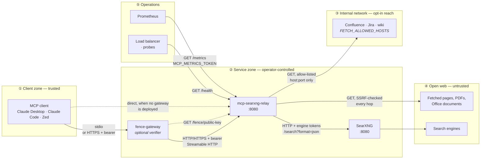

# mcp-searxng-relay

A Model Context Protocol (MCP) server giving AI agents web search and URL fetching through your own self-hosted [SearXNG](https://github.com/searxng/searxng) instance — built for environments where search must stay on approved infrastructure and every query must be auditable. No third-party search APIs, no external data brokers; queries never leave infrastructure you control.

**Who this is for.** Teams running AI agents in environments where outbound search is restricted, monitored, or both — and where "we use a hosted search API" is not an acceptable answer. The project prioritizes a defensible security posture and a clean audit trail over breadth of features.

**What's distinctive.** Most search tooling for agents stops at "here are some results." This relay also tells you what the agent *actually did with them*.

`searxng_session_sources` returns the URLs this relay genuinely fetched for a given caller — byte-exact, newest first, each marked with how much was really read: the full text, one window of a longer document, metadata only, or a fetch that failed. Agents transcribe URLs badly when they compose a final answer thousands of tokens after the tool call that produced it, and fabricate them outright when they never fetched one at all. An instruction like "don't cite sources you haven't read" is unenforceable against a model's recall; against this list it is a lookup. The read-depth distinction is the part that matters — "fetched" and "read in full" are not the same claim, and it is precisely the one models lose.

A hosted search API structurally cannot offer this: it sees one query at a time and keeps no per-caller ledger. The same reasoning runs through the rest of the project — every search and fetch is [attributed to an identity and a session](docs/observability.md#logging), the [SSRF policy](docs/security-model.md#ssrf-protection) is documented and its reach is stated in config rather than inferred, and nothing that would widen a security boundary is allowed to happen silently. If you need to be able to say what your agents searched, what they read, and how much of it, that is what this is for.

Every tool response leaves the relay wrapped in a signed `<sec:fence>` element, implementing the prompt-fencing specification from [Peh, S. (2025), "Prompt Fencing: A Cryptographic Approach to Establishing Security Boundaries in Large Language Model Prompts", arXiv:2511.19727](https://arxiv.org/abs/2511.19727) (referred to below as *the paper*). The boundary between what the relay says and what a fetched page says is cryptographic rather than typographic, so content that tries to impersonate the relay cannot forge its way across it. See [Security notes](#security-notes) for the details.

**Companion projects.** This relay is designed to be deployed alongside [searxng-helm](https://github.com/littleoffice/searxng-helm), a hardened Helm chart for SearXNG on Kubernetes (rootless, read-only rootfs, deny-by-default NetworkPolicies, cosign-signed). The chart deploys both SearXNG and this relay as a pair; see its README for the full infrastructure security story. The relay also ships minimal standalone K8s manifests for quick testing — see [Kubernetes](docs/installation.md#kubernetes).

The second companion is [fence-gateway](https://github.com/littleoffice/fence-gateway), a verifying security gateway — the paper's §4.5 component, and the counterpart this relay's signatures were built for. It sits in the transport between client and relay, checks every `<sec:fence>` signature deterministically, and applies a policy (`reject`, `annotate`, `audit`) before the content can become model context. Verification is what turns the signatures from forward-compatibility into an enforced control; the wire contract a verifier must implement is specified in [`docs/fence-verification.md`](docs/fence-verification.md).

This MCP server supports both the **stdio** transport (for local use with Claude Desktop and similar clients) and the **Streamable HTTP** transport (for networked or containerised deployments).

---

## Contents

- [Features](#features)
- [Architecture](#architecture)
- [Quick start](#quick-start)
- [MCP tools](#mcp-tools)
- [Configuration](#configuration)
- [Security notes](#security-notes)
- [Documentation](#documentation)

---

## Features

- **Verifiable source list** — `searxng_session_sources` returns the URLs the relay actually fetched for a caller, byte-exact and newest-first, each marked with how much of it was read: full text, one window of a longer document, metadata only, or a failed fetch. Agents transcribe URLs badly when composing a final answer far from the tool call that produced them, and fabricate them outright when they never fetched one; this gives the model ground truth to copy from instead of recall, and gives you a record of what it actually read. Delivered in a CDATA-encoded fence so URLs survive the round trip unescaped.
- **Web search** via SearXNG with full control over language, category, time range, safe-search level, and result count
- **URL fetching** with structured Markdown output — headings, lists, tables, code blocks, and inline emphasis all preserved
- **URL metadata triage** — `searxng_url_metadata` returns just title, author, publish date, language, site name, description, image, categories, and tags as JSON, at roughly an order of magnitude lower token cost than fetching the full body. Useful for picking which of several candidate URLs to read in full. Cache is shared with `searxng_read_url`, so a metadata fetch followed by a content fetch (or vice versa) costs one upstream HTTP request, not two.
- **PDF text extraction** from fetched URLs
- **Office document extraction** — DOCX, XLSX, PPTX plus legacy DOC, XLS, PPT. Documents render to Markdown rather than flat text so headings, tables, and list structure survive into the model's context (spreadsheets in particular benefit — a Markdown table is far more useful than CSV-flattened cells)
- **Pagination for long documents** — responses are windowed at 100k characters, and a truncated response ends with a notice naming the total size and the exact `start_index` for the next call. The full extracted text (up to `MAX_EXTRACTED_CHARS`) is cached, so paging through a large PDF costs one upstream fetch, not one per page
- **Image responses** — JPEG, PNG, GIF, and WebP URLs come back as MCP `ImageContent` blocks for vision-model consumption (the SDK base64-encodes the raw bytes on the wire). SVG is intentionally excluded — more useful to the model as text than as a binary blob. Raw size is capped by `MAX_IMAGE_BYTES`, separately from `MAX_BODY_BYTES`, so image and text limits can be tuned independently.
- **Automatic charset detection** — non-UTF-8 pages (Shift-JIS, windows-1252, ISO-8859-1, …) are decoded correctly before parsing
- **Readability-style content extraction** — navigation bars, footers, sidebars, and cookie banners are stripped automatically
- **Degraded-search visibility** — SearXNG answers with HTTP 200 even when some of its backends failed, so a search silently returns thinner results and the first visible symptom is usually someone concluding the model has regressed. The relay reads the `unresponsive_engines` field SearXNG reports and logs a `WARN` naming the engines and why they failed, so a broken backend is diagnosed from the relay's own logs rather than mistaken for a relay or model bug
- **Engine attribution on search results** — each result includes the list of SearXNG backend engines that returned it. A URL surfaced by three engines is a different signal than one surfaced by one, and the agent can weigh that without the server imposing a ranking on top. The `engines` search parameter closes the loop: an agent can re-query the specific backend that surfaced a promising result.
- **Per-domain fetch metrics** — `/metrics` exposes `mcp_fetches_by_domain_total{domain="…",outcome="success|error"}` so an operator can see which destination hosts are healthy and which aren't. Bounded cardinality: at most 512 distinct domains tracked, with the remainder rolled up under `domain="__overflow__"`.
- **Response caching** with configurable TTL and per-request cache bypass
- **SSRF protection** — non-globally-routable addresses are blocked at TCP-dial time (loopback, link-local, private, multicast, broadcast, unspecified, plus a hardcoded blocklist covering CGNAT, TEST-NET-{1,2,3}, benchmark, IETF protocol assignments, NAT64, Teredo, 6to4, IPv6 documentation, ORCHID, the discard prefix, future-reserved 240/4, and other reserved ranges the stdlib predicates miss). Redirect chains are revalidated at every hop to close the DNS-rebinding window. Operators can opt in to reaching internal resources (Confluence, Jira, wikis) via `FETCH_ALLOWED_HOSTS` / `FETCH_ALLOWED_CIDRS`; both require an explicit port, so allow-listing a wiki never also exposes the Redis or kubelet listener beside it.
- **Bearer token authentication** with multi-token tables (`MCP_AUTH_TOKEN`, `MCP_AUTH_TOKENS`, or `MCP_AUTH_TOKEN_FILE`) and per-identity audit logging, or **OAuth 2.0 / OIDC** JWT verification against your own identity provider (`MCP_OAUTH_ISSUER`) — the two can run side by side
- **Per-caller rate limiting** — token-bucket throttle keyed by identity when authenticated and by source IP otherwise. Configurable RPS and burst, default 5 rps / burst 10. Exposed at `mcp_rate_limit_rejections_total`.
- **Prompt fencing** — every tool response is wrapped in a signed `<sec:fence>` element with a per-response random nonce, implementing arXiv:2511.19727. Public key exposed at `/fence/public-key` for forward compatibility with verifying clients. The awareness preamble travels inside its own signed trusted-instruction fence (format 1.1), leaving no unsigned bytes in a response; `FENCE_PREAMBLE=prose` restores the unsigned 1.0 preamble for gateways that predate 1.1. Supply a persistent signing key via `FENCE_SIGNING_KEY` / `FENCE_SIGNING_KEY_FILE` so the verifying gateway can pin its fingerprint; without one the key is per-process and startup warns.
- **Reproducible container builds** — bit-for-bit. Given the same source commit and `SOURCE_DATE_EPOCH`, the build produces a byte-identical image, verifiable via `docker save <image> | sha256sum`. Toolchain pinned by digest, `go.sum` frozen, no embedded paths, VCS state, or build IDs. Details in [`supply-chain.md`](docs/supply-chain.md).
- **Structured startup banner** with all configuration values printed to stderr on start (secrets redacted)

---

## Architecture

Three moving parts, three trust zones. The relay is the only component that
talks to all of them, which is why the security controls live here.



**What each boundary enforces.**

| Boundary | Control | Failure mode it prevents |
|---|---|---|
| ① → ② | Bearer token (`MCP_AUTH_TOKEN*`), per-caller rate limit, cross-origin check | Unauthenticated use; a leaked token driving unbounded traffic |
| ② → ④ | SSRF policy at TCP-dial time, revalidated on every redirect hop | An attacker-supplied URL reaching loopback, RFC 1918, or cloud metadata |
| ② → ③ | `FETCH_ALLOWED_HOSTS` / `FETCH_ALLOWED_CIDRS`, both port-mandatory | Allow-listing a wiki and getting its Redis listener for free |
| ④ → ① | Prompt fence: signed `<sec:fence>`, per-response nonce, awareness preamble | Fetched content impersonating the relay or escaping its boundary |

The fence is the only control on the last row, and it is the only one whose
enforcement point is outside this process — either the consuming model honours
the preamble, or a verifying gateway checks the signature deterministically.

How one search-then-read turn moves through these parts: [Communication](docs/architecture.md#communication).

---

## Quick start

You need a SearXNG instance with its JSON output format enabled ([how](docs/installation.md#enabling-json-format-in-searxng)).

### Docker (recommended)

```bash
docker run -d \
  -e SEARXNG_URL=https://your-searxng-instance.example.com \
  -e MCP_PORT=8080 \
  -e MCP_AUTH_TOKEN=$(openssl rand -hex 32) \
  -p 8080:8080 \
  ghcr.io/littleoffice/mcp-searxng-relay:latest
```

Then connect a client: Claude Desktop over [HTTP](docs/installation.md#using-with-claude-desktop-http-mode) or [stdio](docs/installation.md#using-with-claude-desktop-stdio-mode). Docker Compose, building the image yourself and Kubernetes are in [docs/installation.md](docs/installation.md).

---

## MCP tools

| Tool | What it does |
|---|---|
| [`searxng_web_search`](docs/tools.md#searxng_web_search) | Execute a web search and return titles, URLs, and snippets. |
| [`searxng_read_url`](docs/tools.md#searxng_read_url) | Fetch a URL and return its content: HTML and Office documents as structured Markdown, PDF and plain text as text, images as image blocks. Long documents are paginated. |
| [`searxng_url_metadata`](docs/tools.md#searxng_url_metadata) | Fetch only the structured metadata for a URL (title, author, publish date, language, …), without the page body. |
| [`searxng_session_sources`](docs/tools.md#searxng_session_sources) | Return the URLs this relay has fetched for the calling identity, newest first, byte-exact. |

Parameters, output shapes and examples: [docs/tools.md](docs/tools.md).

---

## Configuration

All configuration is via environment variables. Most deployments set these:

| Variable | Purpose |
|---|---|
| `SEARXNG_URL` | Base URL of your SearXNG instance. Required |
| `MCP_PORT` | Serve Streamable HTTP on this port; unset means stdio |
| `MCP_AUTH_TOKEN` / `MCP_AUTH_TOKEN_FILE` | Bearer token(s) callers must present in HTTP mode, or use [OAuth 2.0 / OIDC](docs/configuration.md#oauth-20--oidc) instead |
| `FENCE_SIGNING_KEY_FILE` | Persistent fence signing key, so a verifying gateway can pin it ([why](docs/prompt-fencing.md#fence-signing-key)) |
| `MCP_METRICS_TOKEN` | Required to scrape `/metrics` |

Every variable, with its default: [docs/configuration.md](docs/configuration.md).

---

## Security notes

- **Prompt injection is the primary runtime risk.** Everything the tools return was written by third parties. [Prompt injection](docs/security-model.md#prompt-injection)
- **Signed fences.** Every response is wrapped in an Ed25519-signed `<sec:fence>`, the awareness preamble included under the default format 1.1, so a verifying gateway such as [fence-gateway](https://github.com/littleoffice/fence-gateway) can check it deterministically. [Prompt fencing](docs/prompt-fencing.md) · [verifier contract](docs/fence-verification.md)
- **Hidden text is removed** before fencing: invisible Unicode characters and HTML elements a browser would not render. [Hidden-text removal](docs/security-model.md#hidden-text-removal)
- **SSRF protection** at TCP-dial time, re-checked on every redirect hop. Reaching internal hosts is opt-in and port-scoped. [SSRF protection](docs/security-model.md#ssrf-protection)
- **Authentication** by static bearer tokens or OAuth 2.0 / OIDC JWT verification, with every call attributed to an identity. [Authentication](docs/security-model.md#authentication) · [OAuth 2.0 verification](docs/security-model.md#oauth-20-verification)
- **Container.** Non-root on a `scratch` base, built reproducibly. [Container hardening](docs/security-model.md#container-hardening) · [supply-chain statement](docs/supply-chain.md)

Report vulnerabilities privately: see [docs/SECURITY.md](docs/SECURITY.md).

---

## Documentation

| Document | Contents |
|---|---|
| [Installation](docs/installation.md) | Requirements, Docker Compose, building the image, Kubernetes, Claude Desktop |
| [Configuration](docs/configuration.md) | Every environment variable; tokens, OAuth, session modes, rate limiting, engine scoping |
| [MCP tools](docs/tools.md) | Parameters, output shapes and examples for each tool |
| [Architecture](docs/architecture.md) | One search-then-read turn, step by step |
| [Security model](docs/security-model.md) | Prompt injection, hidden-text removal, SSRF, authentication, hardening |
| [Prompt fencing](docs/prompt-fencing.md) | Fence layout, the signed preamble, the signing key |
| [Operations](docs/operations.md) | Caches, health checks, graceful shutdown, HTTP timeouts, TLS |
| [Logging and metrics](docs/observability.md) | Startup banner, log fields, Prometheus series |
| [Caches](docs/caching.md) | Inventory of every cache and bounded store, and how to size them |
| [Fence verification contract](docs/fence-verification.md) | Normative wire format and verification procedure for verifiers |
| [Supply-chain statement](docs/supply-chain.md) | Dependencies, build provenance, reproducibility, known gaps |
| [Security policy](docs/SECURITY.md) | Supported versions and how to report a vulnerability |
