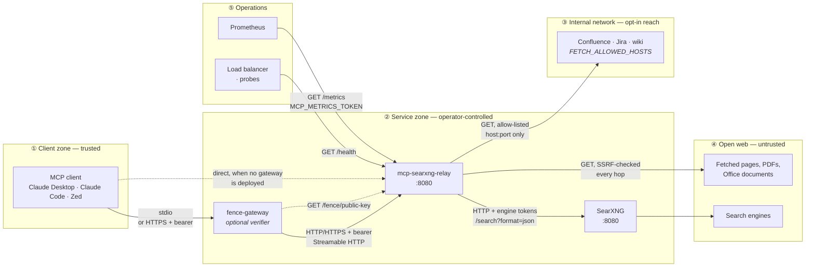

# mcp-searxng-relay

A Model Context Protocol (MCP) server giving AI agents web search and URL fetching through your own self-hosted [SearXNG](https://github.com/searxng/searxng) instance — built for environments where search must stay on approved infrastructure and every query must be auditable. No third-party search APIs, no external data brokers; queries never leave infrastructure you control.

**Who this is for.** Teams running AI agents where outbound search is restricted, monitored, or both, and where "we use a hosted search API" is not an acceptable answer. The project puts a defensible security posture and a clean audit trail ahead of breadth of features: every search and fetch is attributed to an identity and a session, and nothing that would widen a security boundary happens silently.

**What's distinctive.** Most search tooling for agents stops at "here are some results." This relay also tells you what the agent *actually did with them*. [`searxng_session_sources`](docs/tools.md#searxng_session_sources) returns the URLs the relay really fetched for a caller, byte-exact, each marked with how much was read: the full text, one window of a longer document, metadata only, or a fetch that failed. "Don't cite sources you haven't read" is unenforceable against a model's recall; against this list it is a lookup. A hosted search API cannot offer this: it sees one query at a time and keeps no per-caller ledger.

**Signed responses.** Every tool response leaves the relay wrapped in an Ed25519-signed `<sec:fence>` element, implementing [Peh, S. (2025), "Prompt Fencing: A Cryptographic Approach to Establishing Security Boundaries in Large Language Model Prompts", arXiv:2511.19727](https://arxiv.org/abs/2511.19727) (*the paper*). The boundary between what the relay says and what a fetched page says is cryptographic rather than typographic, and [fence-gateway](https://github.com/littleoffice/fence-gateway) can verify it before the content reaches the model.

The relay speaks both MCP transports: **stdio** for local clients such as Claude Desktop, and **Streamable HTTP** for networked or containerised deployments.

---

## Contents

- [Features](#features)
- [Architecture](#architecture)
- [Quick start](#quick-start)
- [MCP tools](#mcp-tools)
- [Configuration](#configuration)
- [Security notes](#security-notes)
- [Documentation](#documentation)
- [Companion projects](#companion-projects)
- [License](#license)

---

## Features

- **[Verifiable source list](docs/tools.md#searxng_session_sources)** — the URLs the relay actually fetched for a caller, byte-exact and newest first, each marked with how much was read: ground truth for citations instead of the model's recall.
- **[Web search](docs/tools.md#searxng_web_search)** through SearXNG, with language, category, time range, safe-search level, result count and engine selection.
- **[Engine attribution](docs/tools.md#searxng_web_search)** — every result lists the SearXNG engines that returned it, a corroboration signal the agent can weigh.
- **[URL fetching](docs/tools.md#searxng_read_url)** to structured Markdown — headings, lists, tables, code blocks and emphasis preserved; navigation bars, footers, sidebars and cookie banners stripped.
- **[PDF and Office documents](docs/tools.md#searxng_read_url)** — PDF text with page markers; DOCX, XLSX, PPTX and legacy DOC, XLS, PPT rendered to Markdown, so headings and tables survive.
- **[Pagination](docs/tools.md#searxng_read_url)** — long documents in 100,000-character windows with exact continuation offsets; later pages come from the cache.
- **[Images](docs/tools.md#searxng_read_url)** — JPEG, PNG, GIF and WebP returned as MCP image content for vision models.
- **[Metadata triage](docs/tools.md#searxng_url_metadata)** — title, author, date, language and more as JSON, at roughly an order of magnitude fewer tokens than a full read, sharing its cache.
- **[Charset detection](docs/tools.md#searxng_read_url)** — Shift-JIS, windows-1252, ISO-8859-1 and other non-UTF-8 pages decode correctly.
- **[Degraded-search visibility](docs/observability.md#logging)** — when SearXNG backends fail behind an HTTP 200, the relay logs which engines failed and why, and counts it.
- **[Signed responses](docs/prompt-fencing.md)** — every response in an Ed25519-signed `<sec:fence>` with a per-response nonce, the awareness preamble included (format 1.1, the default).
- **[Hidden-text removal](docs/security-model.md#hidden-text-removal)** — invisible Unicode characters and HTML elements a browser would not render are removed before fencing, counted, and noted to the model.
- **[SSRF protection](docs/security-model.md#ssrf-protection)** — non-public addresses blocked at TCP-dial time and re-checked on every redirect hop; internal hosts reachable only through explicit, port-scoped allow-lists.
- **[Authentication](docs/security-model.md#authentication)** — static bearer tokens with per-identity audit logging, or [OAuth 2.0 / OIDC](docs/configuration.md#oauth-20--oidc) JWT verification against your own identity provider; the two can run side by side.
- **[Per-caller rate limiting](docs/configuration.md#rate-limiting)** — a token bucket per caller, default 5 requests per second with a burst of 10.
- **[Response caching](docs/caching.md)** with a configurable TTL and per-request bypass.
- **[Metrics](docs/observability.md#metrics)** — Prometheus series for traffic, errors, latency, the cache, the SSRF guard and per-domain fetches (bounded cardinality), behind a token of their own.
- **[Reproducible builds](docs/installation.md#building-the-container-image)** — the same commit and `SOURCE_DATE_EPOCH` produce a byte-identical image, with the toolchain pinned by digest. See the [supply-chain statement](docs/supply-chain.md).
- **[Startup banner](docs/observability.md#logging)** — every active setting printed at start with secrets redacted, so the running configuration can be read off the logs.

---

## Architecture

Three moving parts, three trust zones. The relay is the only component that
talks to all of them, which is why the security controls live here.



**What each boundary enforces.**

| Boundary | Control | Failure mode it prevents |
|---|---|---|
| ① → ② | Bearer token (`MCP_AUTH_TOKEN*`), per-caller rate limit, cross-origin check | Unauthenticated use; a leaked token driving unbounded traffic |
| ② → ④ | SSRF policy at TCP-dial time, revalidated on every redirect hop | An attacker-supplied URL reaching loopback, RFC 1918, or cloud metadata |
| ② → ③ | `FETCH_ALLOWED_HOSTS` / `FETCH_ALLOWED_CIDRS`, both port-mandatory | Allow-listing a wiki and getting its Redis listener for free |
| ④ → ① | Prompt fence: signed `<sec:fence>`, per-response nonce, awareness preamble | Fetched content impersonating the relay or escaping its boundary |

The fence is the only control on the last row, and it is the only one whose
enforcement point is outside this process — either the consuming model honours
the preamble, or a verifying gateway checks the signature deterministically.

How one search-then-read turn moves through these parts: [Communication](docs/architecture.md#communication).

---

## Quick start

You need a SearXNG instance with its JSON output format enabled ([how](docs/installation.md#enabling-json-format-in-searxng)).

### Docker (recommended)

```bash
docker run -d \
  -e SEARXNG_URL=https://your-searxng-instance.example.com \
  -e MCP_PORT=8080 \
  -e MCP_AUTH_TOKEN=$(openssl rand -hex 32) \
  -p 8080:8080 \
  ghcr.io/littleoffice/mcp-searxng-relay:latest
```

Then connect a client: Claude Desktop over [HTTP](docs/installation.md#using-with-claude-desktop-http-mode) or [stdio](docs/installation.md#using-with-claude-desktop-stdio-mode). Docker Compose, building the image yourself and Kubernetes are in [docs/installation.md](docs/installation.md).

---

## MCP tools

| Tool | What it does |
|---|---|
| [`searxng_web_search`](docs/tools.md#searxng_web_search) | Execute a web search and return titles, URLs, and snippets. |
| [`searxng_read_url`](docs/tools.md#searxng_read_url) | Fetch a URL and return its content: HTML and Office documents as structured Markdown, PDF and plain text as text, images as image blocks. Long documents are paginated. |
| [`searxng_url_metadata`](docs/tools.md#searxng_url_metadata) | Fetch only the structured metadata for a URL (title, author, publish date, language, …), without the page body. |
| [`searxng_session_sources`](docs/tools.md#searxng_session_sources) | Return the URLs this relay has fetched for the calling identity, newest first, byte-exact. |

Parameters, output shapes and examples: [docs/tools.md](docs/tools.md).

---

## Configuration

All configuration is via environment variables. Most deployments set these:

| Variable | Purpose |
|---|---|
| `SEARXNG_URL` | Base URL of your SearXNG instance. Required |
| `MCP_PORT` | Serve Streamable HTTP on this port; unset means stdio |
| `MCP_AUTH_TOKEN` / `MCP_AUTH_TOKEN_FILE` | Bearer token(s) callers must present in HTTP mode, or use [OAuth 2.0 / OIDC](docs/configuration.md#oauth-20--oidc) instead |
| `FENCE_SIGNING_KEY_FILE` | Persistent fence signing key, so a verifying gateway can pin it ([why](docs/prompt-fencing.md#fence-signing-key)) |
| `MCP_METRICS_TOKEN` | Required to scrape `/metrics` |

Every variable, with its default: [docs/configuration.md](docs/configuration.md).

---

## Security notes

**Prompt injection is the primary runtime risk**: everything the tools return was written by third parties. The relay answers it in layers, and each page states what its layer does *not* do:

| Layer | What it gives you | Details |
|---|---|---|
| Signed fences | Provenance: a verifier can prove which bytes the relay emitted | [Prompt fencing](docs/prompt-fencing.md) |
| Hidden-text removal | Text a reader never sees (invisible characters, hidden elements) is deleted | [Hidden-text removal](docs/security-model.md#hidden-text-removal) |
| SSRF policy | Fetches cannot reach non-public addresses unless you allow-list them | [SSRF protection](docs/security-model.md#ssrf-protection) |
| Authentication | Every call is tied to an identity in the audit log | [Authentication](docs/security-model.md#authentication) |
| Container | Non-root on a `scratch` base, reproducible build | [Container hardening](docs/security-model.md#container-hardening) |

None of these makes a model ignore instructions written in content it reads; a signature proves where bytes came from, not that they are safe to act on. See [Prompt injection](docs/security-model.md#prompt-injection).

Report vulnerabilities privately: [docs/SECURITY.md](docs/SECURITY.md). Build provenance: [docs/supply-chain.md](docs/supply-chain.md).

---

## Documentation

| Document | Contents |
|---|---|
| [Installation](docs/installation.md) | Requirements, Docker Compose, building the image, Kubernetes, Claude Desktop |
| [Configuration](docs/configuration.md) | Every environment variable; tokens, OAuth, session modes, rate limiting, engine scoping |
| [MCP tools](docs/tools.md) | Parameters, output shapes and examples for each tool |
| [Architecture](docs/architecture.md) | One search-then-read turn, step by step |
| [Security model](docs/security-model.md) | Prompt injection, hidden-text removal, SSRF, authentication, hardening |
| [Prompt fencing](docs/prompt-fencing.md) | Fence layout, the signed preamble, the signing key |
| [Operations](docs/operations.md) | Caches, health checks, graceful shutdown, HTTP timeouts, TLS |
| [Logging and metrics](docs/observability.md) | Startup banner, log fields, Prometheus series |
| [Caches](docs/caching.md) | Inventory of every cache and bounded store, and how to size them |
| [Fence verification contract](docs/fence-verification.md) | Normative wire format and verification procedure for verifiers |
| [Supply-chain statement](docs/supply-chain.md) | Dependencies, build provenance, reproducibility, known gaps |
| [Security policy](docs/SECURITY.md) | Supported versions and how to report a vulnerability |

---

## Companion projects

- **[searxng-helm](https://github.com/littleoffice/searxng-helm)** — a hardened Helm chart that deploys SearXNG and this relay as a pair on Kubernetes (rootless, read-only rootfs, deny-by-default NetworkPolicies, cosign-signed). It is the reference deployment; the relay's own [manifests](docs/installation.md#kubernetes) are for quick testing.
- **[fence-gateway](https://github.com/littleoffice/fence-gateway)** — the verifying security gateway, the paper's §4.5 component. It sits between client and relay, checks every `<sec:fence>` signature deterministically, and applies a policy (`reject`, `annotate`, `audit`) before content becomes model context. Verification is what turns the signatures into an enforced control; the wire contract is in [docs/fence-verification.md](docs/fence-verification.md).

---

## License

AGPL-3.0. See [LICENSE](LICENSE).
