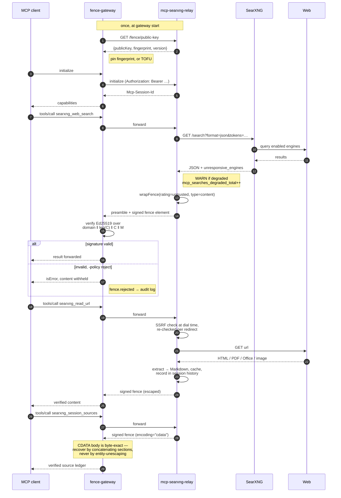

# Architecture

The component overview and what each trust boundary enforces are in the [README](../README.md#architecture). This page follows one request through them.

## Communication

One search-then-read turn, with the optional verifying gateway in place. Without
a gateway, the client's arrows go straight to the relay and the verify step
simply does not happen.

The last exchange is the one a verifier is most likely to get wrong, and the
reason [`docs/fence-verification.md`](fence-verification.md) exists: that
response carries `encoding="cdata"`, and a verifier that assumes the
entity-escaped form recovers different bytes than were signed and rejects a
perfectly good fence.

The diagram draws one fence per response for readability. Under the default
format 1.1 each of those responses carries two: the awareness preamble in its
own signed `rating="trusted"` fence, then the content fence — so the gateway
can enforce that no unsigned bytes reached the model at all. Under
`FENCE_PREAMBLE=prose` (format 1.0, for gateways that predate 1.1) the
preamble travels as unsigned prose ahead of the single fence instead. See
[Fenced awareness preamble](prompt-fencing.md#fenced-awareness-preamble), and the wire contract for what a
verifier must check across the pair.
