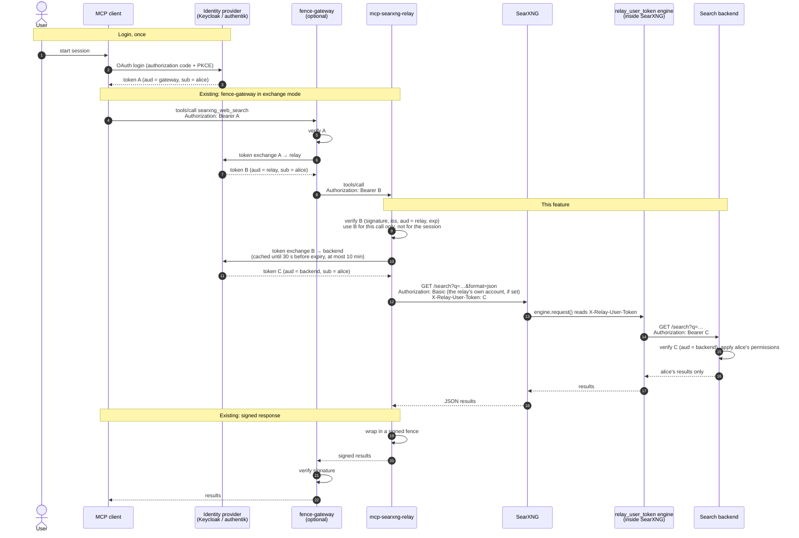

# Per-user tokens for SearXNG engines

By default the relay talks to SearXNG as itself, so every caller reaches every
engine with the same upstream identity. For public web engines that is the
point. For an engine in front of a permission-aware system, such as a wiki, a
ticket tracker or a document store, it means the engine can only ever search as
a shared service account.

With `SEARXNG_USER_TOKEN_MODE=exchange`, each search carries an OAuth access
token **for the user behind the MCP call**, issued by your identity provider
**for the search backend**. A small custom SearXNG engine hands it to the
backend, which applies that user's own permissions. The user logs in once.

## Contents

- [How it works](#how-it-works)
- [What you need](#what-you-need)
- [Relay settings](#relay-settings)
- [Identity provider](#identity-provider)
  - [Keycloak](#keycloak)
  - [authentik](#authentik)
- [The SearXNG engine](#the-searxng-engine)
- [The backend](#the-backend)
- [Deployment rules](#deployment-rules)
- [Security properties](#security-properties)
- [Limits and caveats](#limits-and-caveats)
- [Testing](#testing)

## How it works



Without fence-gateway, the MCP client logs in for the relay directly and sends
token B itself; everything from step 8 on is the same.

Each hop gets its own token, all for the same user:

| Token | Audience | Accepted by | Never sent to |
|---|---|---|---|
| A | gateway | fence-gateway | relay, SearXNG, backend |
| B | relay | mcp-searxng-relay | SearXNG, backend |
| C | backend | your backend | the MCP client, the model |

A token that leaks is good at one place only.

## What you need

1. The relay verifying OAuth tokens (`MCP_OAUTH_ISSUER`, `MCP_OAUTH_AUDIENCE`;
   see [OAuth 2.0 / OIDC](configuration.md#oauth-20--oidc)). Exchange mode
   refuses to start without it: only a verified OAuth token identifies a user.
2. An identity provider that implements [RFC 8693](https://www.rfc-editor.org/rfc/rfc8693)
   token exchange, with a client for the relay that may exchange relay tokens
   for backend tokens.
3. The [`relay_user_token`](../deploy/searxng-engine/relay_user_token.py) engine
   installed in SearXNG.
4. A backend that verifies the token it receives.

## Relay settings

| Variable | Required | Description |
|---|---|---|
| `SEARXNG_USER_TOKEN_MODE` | — | `off` (default) or `exchange`. `passthrough` is refused on purpose: forwarding the caller's own token would make it valid at the backend too |
| `SEARXNG_USER_TOKEN_URL` | with exchange | The provider's token endpoint. Must be `https://` (plain `http` only to loopback) |
| `SEARXNG_USER_TOKEN_CLIENT_ID` | with exchange | The relay's client at the provider |
| `SEARXNG_USER_TOKEN_CLIENT_SECRET` / `_FILE` | with exchange | Its secret; one or the other, not both |
| `SEARXNG_USER_TOKEN_AUDIENCE` | no | Sent as the RFC 8693 `audience` parameter: the backend's client ID. Keycloak needs it; authentik issues for the requesting client and can leave it unset |
| `SEARXNG_USER_TOKEN_ALLOW_PLAINTEXT` | no | `true` permits a plain `http://` `SEARXNG_URL` to another host. Without it the relay refuses to start rather than send users' tokens in clear text. Set it only when the path is private and locked down, for example in-cluster behind a NetworkPolicy |

`MCP_OAUTH_CA_ROOTS`, when set, is also the trust store for the token endpoint,
which normally lives at the same provider as the issuer.

Every misconfiguration stops startup: settings without the mode, exchange
without OAuth verification, a missing client or secret, an `http://` token
endpoint, or a plaintext `SEARXNG_URL` without the opt-in.

The banner shows the state, never the secret:

```text
searxng user token exchange (client relay-client, audience search-backend, header X-Relay-User-Token)
```

## Identity provider

The relay acts as an OAuth client that exchanges tokens issued **for the relay**
(`aud` = `MCP_OAUTH_AUDIENCE`) for tokens issued **for the backend**. Before
pointing the relay at your provider, try the exchange by hand with a real relay
token; if this works, the relay will too:

```bash
curl -s -u "$CLIENT_ID:$CLIENT_SECRET" "$TOKEN_URL" \
  -d grant_type=urn:ietf:params:oauth:grant-type:token-exchange \
  -d subject_token="$RELAY_TOKEN" \
  -d subject_token_type=urn:ietf:params:oauth:token-type:access_token \
  -d requested_token_type=urn:ietf:params:oauth:token-type:access_token \
  -d audience="$BACKEND_CLIENT_ID"
```

Decode the returned `access_token` and check that `sub` is the user and `aud`
is the backend.

### Keycloak

Standard token exchange (Keycloak 26.2 and newer) lets a client exchange a token
that has that client in its audience.

1. **Relay client** (`relay-client`): confidential, **Standard token exchange**
   enabled. Its ID and secret go into `SEARXNG_USER_TOKEN_CLIENT_ID` and
   `SEARXNG_USER_TOKEN_CLIENT_SECRET`.
2. **Tokens the relay receives** must carry `relay-client` in `aud`, so add an
   audience mapper to the client those tokens are issued to (the MCP client's,
   or fence-gateway's relay client). The relay's `MCP_OAUTH_AUDIENCE` must be a
   value those tokens carry in `aud`.
3. **Backend client** (`search-backend`): the target. Set
   `SEARXNG_USER_TOKEN_AUDIENCE=search-backend`.
4. `SEARXNG_USER_TOKEN_URL` is
   `https://<keycloak>/realms/<realm>/protocol/openid-connect/token`.

### authentik

Token exchange is a grant type on the OAuth2 provider, off by default.

1. **Provider for the backend**: an OAuth2/OpenID provider and application,
   confidential client. Enable the token exchange grant type and add the
   provider that issues the relay's tokens under **Federated OAuth2/OpenID
   Providers**, so it accepts them as subject tokens. Its client ID and secret
   go into `SEARXNG_USER_TOKEN_CLIENT_ID` / `_SECRET`; tokens it issues carry
   its client ID as `aud`, which is what the backend checks.
2. `SEARXNG_USER_TOKEN_URL` is `https://<authentik>/application/o/token/`.

Check the names against your version's
[token exchange documentation](https://docs.goauthentik.io/add-secure-apps/providers/oauth2/token_exchange/).

## The SearXNG engine

[`deploy/searxng-engine/relay_user_token.py`](../deploy/searxng-engine/relay_user_token.py)
reads `X-Relay-User-Token` and sends the token to the backend as
`Authorization: Bearer`. Copy it into SearXNG's `searx/engines/` directory (in
the official image, `/usr/local/searxng/searx/engines/`) and add it to
`settings.yml`:

```yaml
engines:
  - name: private
    engine: relay_user_token
    shortcut: priv
    base_url: https://backend.internal/api/search
    categories: [general]
    disabled: true
```

- `disabled: true` keeps it out of ordinary searches; the model reaches it by
  name (`engines: private`) or with `!priv`. Advertise it with
  [`SEARXNG_ENGINES`](configuration.md#advertising-engines-to-the-model).
- Optionally gate it with a [private-engine token](configuration.md#scoping-a-relay-to-specific-engines)
  as well, so only relays holding that token can select it.
- `response()` parses `{"results": [{"url", "title", "content"}]}`. Adapt it to
  your backend.

What the engine guarantees:

- **No token, no request.** Without a usable header the engine sends nothing.
  There is no shared-credential fallback, so people using SearXNG's web UI
  directly, static-token callers and anything else without a user get nothing
  from the backend.
- **A 401/403 does not suspend the engine.** SearXNG suspends an engine for
  every user when it sees an access error; the engine handles those itself, so
  one user's expired token returns nothing to that user and nothing else.
- **The token goes only to `base_url`.** Redirects are not followed, and the
  engine refuses to start unless `base_url` is `https://` (plain `http` only to
  loopback, which also needs `enable_http: true` on the engine).
- **The token is never logged or stored** in module state, which every
  concurrent search shares.

How the engine reads the header: SearXNG runs each engine in a thread wrapped in
Flask's `copy_current_request_context` (`searx/search/__init__.py`, added in
August 2023 so engines can use translations, and unchanged since). That makes
the incoming request, headers included, visible to the engine. It is not a
documented engine API. If a future SearXNG drops it, the engine logs an error
and returns nothing: it fails closed. Pin your SearXNG image by digest and keep
the end-to-end check from [Testing](#testing) in your upgrade routine.

## The backend

All of the security of the last hop rests on the backend verifying token C
properly, with a maintained JWT library:

- the signature, against the provider's JWKS, asymmetric algorithms only;
- `iss` is your provider, `aud` is the backend, `exp` and `nbf` hold;
- the subject is a real user. The relay only exchanges tokens of callers it
  verified as OAuth users, but a service account holding a relay-audience token
  would be exchanged too; reject subjects that are not people if that matters.

## Deployment rules

- **Only the relay may reach SearXNG.** Anyone who can reach SearXNG can set
  the header. They cannot forge a token the backend accepts, but they can
  replay a stolen one until it expires. Turn SearXNG's own ingress off and
  restrict it to the relay with a NetworkPolicy (in searxng-helm:
  `networkPolicy.ingress.allowSameNamespace: false`, which still admits the
  chart's relay instances).
- **Keep the token path encrypted or private.** Use `https://` for
  `SEARXNG_URL`, or set `SEARXNG_USER_TOKEN_ALLOW_PLAINTEXT=true` only for
  in-cluster traffic you have locked down.
- **Do not route the private engine through SearXNG's outgoing proxies or Tor.**
- **Use fence-gateway in `exchange` mode**, not `passthrough`, so the relay
  never holds a token that also works at the gateway.

## Security properties

Each of these is pinned by a test in
[`searxng_user_token_test.go`](../searxng_user_token_test.go).

| Property | Why |
|---|---|
| The caller's own token never reaches SearXNG | Only the exchanged token, issued for the backend, is sent |
| Static-token callers get no user token | They have no user identity; their searches run without the header and the private engine returns nothing |
| A failed exchange fails the search | The caller sees a generic error and the reason goes to the log; nothing is sent under no identity or another one |
| Each request uses its own token | The token comes from the HTTP request carrying the tool call, so a refreshed token is used mid-session |
| Shared sessions stay per-caller | On a stateful session several callers use (fence-gateway opens its relay sessions under its own credential), each search carries the exchanged token of its own caller, never the session opener's |
| The token never follows a redirect | Token-bearing searches and token-endpoint calls refuse every redirect; Go would otherwise forward the header to whatever host a redirect names |
| Tokens never reach logs, metrics or the model | Not even at debug level; the cache is keyed by a SHA-256 of the caller's token |
| Exchanged tokens are reused for at most 10 minutes | A user removed at the provider stops reaching the backend within that window, whatever lifetime the provider issues |
| Only searches carry it | URL fetches, engine discovery and health probes never do |

## Limits and caveats

- **Search only.** `searxng_read_url` does not carry the user token. Internal
  URLs in private results are fetched, if at all, as the relay, under
  [`FETCH_ALLOWED_HOSTS`](security-model.md#reaching-internal-resources-opt-in),
  and the URL content cache is shared by every caller ([Caches](caching.md)).
  Do not allow-list hosts that need a user's own permissions.
- **Exfiltration.** Private results land in the model's context, and a prompt
  injection can try to send them out through `searxng_read_url` to a host the
  attacker controls. Keep `FETCH_URL_PROVENANCE` at its default, `enforce`,
  which refuses URLs the relay never showed the caller, keep
  `FETCH_ALLOWED_HOSTS` empty or narrow, and consider a separate relay instance
  for private engines.
- **Every search carries the token**, not only those that select the private
  engine, because SearXNG resolves `!bang` syntax itself and the relay cannot
  know in advance which engines a query reaches. Only the private engine reads
  it.
- **One exchange per user per token lifetime.** The relay caches up to 1024
  exchanged tokens; a busy deployment with more concurrent users exchanges more
  often.

## Testing

The unit and end-to-end tests run with the rest of the suite (`go test ./...`).
To check a deployment by hand, end to end:

1. Search as two different users with the private engine selected
   (`engines: private`). Each sees only their own results.
2. Search with a static token. The private engine returns nothing, and the
   backend log shows no call.
3. Query SearXNG directly without the header, and with a made-up one. Nothing
   comes back, and a later search by a real user still works (the engine was
   not suspended).
4. Read `mcp_searxng_user_token_total` on `/metrics`: `exchanged` and `cached`
   grow with searches, `failed` stays at zero.
5. Search the relay and SearXNG logs for `eyJ` (the start of every JWT). There
   should be no match.
